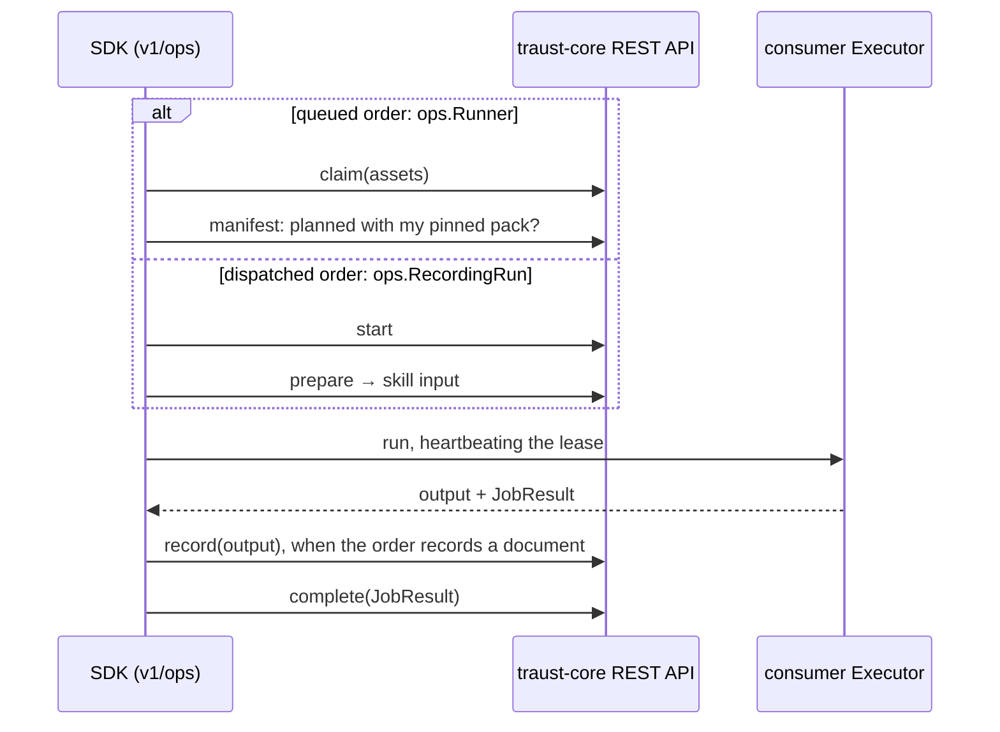

# traust-sdk (Go)

Program against traust: read its inventory, findings, dashboards and reports, keep inventory current, and
run work for it. Every call goes to traust-core's REST API; the SDK handles auth, retries,
paging, typed errors and the run lifecycle.

```bash
go get github.com/traust-security/traust-sdk/go
```

## Quickstart

```go
import "github.com/traust-security/traust-sdk/go/v1/traust"

client, err := traust.NewClient(traust.Config{
    BaseURL: "https://traust-core.example.com",
    Tokens:  traust.FileTokenSource{Path: "/var/run/secrets/traust-core/token"},
})

url := "https://github.com/example/api"
repos, err := client.ListRepositories(ctx, &traust.ListRepositoriesParams{Url: &url})
repo := repos.Items[0]

counts, err := client.SummarizeFindings(ctx, *repo.Id,
    &traust.SummarizeFindingsParams{GroupBy: traust.FindingDimensionSeverity})
```

Every operation is a method named after core's operation — `client.GetRepository(ctx, id)` returns
`(*traust.Repository, error)`; `go doc ./v1/traust` shows every signature and the runnable examples.

## Connect

| Token | Use |
|---|---|
| `traust.FileTokenSource{Path}` | services: re-reads the file on every request, so rotated tokens just work |
| `traust.StaticToken("…")` | scripts, local development and tests |

`Config` also takes your own `*http.Client`, the retry count and the backoff. Reads (GET)
retry on 429, 502, 503, 504 and transport errors; writes are never retried.

A `LoadConfig` profile can name a machine identity instead of a `token_file`: `token_url`, `client_id`,
`client_secret_file` (a leading `~/` expands), optional `scopes` — the secret is read from the file, never the config.

## Read

```go
finding, err := client.GetFinding(ctx, id)            // one resource
page, err := client.ListFindings(ctx, repoID, nil)     // one page
for f, err := range client.ListFindingsAll(ctx, repoID, nil) { … } // every page
```

Each paged listing has an `…All` iterator that follows the cursor and stops at the first error. Counts and dashboards
come from `QueryDashboard`, `SummarizeFindings` and `SummarizeExposure`, reports from `BeginRequestReport` — never from listings.

### Dashboards

One query answers a dashboard card: what to count, broken down by up to three dimensions, over
the repositories (or products, teams) the person may see. Rows read by typed key:

```go
result, err := client.QueryDashboard(ctx, traust.DashboardQuery{
    Subject:       traust.SubjectFindings,
    Measures:      []traust.Measure{traust.MeasureFindings},
    GroupBy:       &[]traust.Dimension{traust.DimensionSeverity},
    RepositoryIds: &repoIDs,
})
for _, row := range result.Rows {
    severity, count := row.Group(traust.DimensionSeverity), row.Measure(traust.MeasureFindings)
}
```

### Reports

A report is a job core builds; follow the build, then download the file. A `json` report is the
view itself, and `ReportView` decodes it as its generated `…Insight` type, refusing a field
outside the contract:

```go
format := traust.ReportFormatMarkdown
poller, err := client.BeginRequestReport(ctx, traust.ReportRequest{Report: traust.FindingsRollup, Format: &format})
report, err := poller.Wait(ctx, 2*time.Second)         // ready or failed; ResumeReport(token) after a restart
file, err := client.GetReportFile(ctx, report.OrderId) // the stored bytes, whatever the format

rollup, err := traust.ReportView[traust.FindingsRollupInsight](ctx, client, report) // a ready json report
```

A view composed from others uses their types: `ExecutiveSummaryInsight.Rollup` is a
`FindingsRollupInsight`, its `Pqc` a `*PqcPortfolioInsight` (nil when the panel was not asked
for), its isolation panel's `ThreatRegister` a `ThreatRegisterInsight`, and so on. Shared
contract definitions generate once and are reused: the finding records views embed are
`FindingRecordsInsightFindingView`, `FindingRecordsInsightOccurrence`,
`FindingRecordsInsightDecision` (`ContainerFindingsInsight` rows carry them).

### Query orders

`client.QueryOrders(ctx, traust.OrderQueryRequest{…})` posts filters, search, sort and bounded
paging to `POST /v1/orders/query`. Each item contains the order, its repository URL (nullable)
and an opaque cursor. Follow the page's `Next` for a whole page, or the last consumed item's
`Cursor` when merging only part of a page with another source. Keep filters and sorting
unchanged when resuming; the limit may change (1–1000). Malformed or mismatched cursors return
a typed validation problem.

`q` is a literal case-insensitive substring search across the displayed repository reference
(URL, else repository ID, else order ID), asset and state. Normal sorts use the requested
direction, then order ID, with nulls last. `sort_by=ids` preserves the supplied distinct ID
sequence regardless of direction; `ids=null` is unrestricted and `ids=[]` matches nothing.
Each ID selector accepts at most 500 values; oversized requests fail validation
rather than silently dropping IDs. Live mutable sort/filter values can change
between pages: these cursors are not transactional snapshots.
Use these server-side queries rather than walking order history to filter or sort it.
As a POST, `QueryOrders` is not automatically retried.

`client.QueryOrdersAll(ctx, request)` iterates the remaining matching items
from `request.Cursor`, following page boundaries and yielding the first error.
It stops fetching when the consumer stops. Use it for intentional full-history
processing; interactive tables and mixed-source merges should keep using
bounded `QueryOrders` pages rather than draining this iterator before rendering.

## Keep inventory current

```go
client.Onboard(ctx, traust.OnboardingRequest{…})                     // product, repositories, refs, teams
client.RegisterRef(ctx, repoID, traust.RefRegistration{Sha: sha})     // a commit you're about to scan
client.SetOwners(ctx, repoID, traust.Owners{Teams: []string{"red"}})  // the teams your source reports
```

Writes are idempotent: re-sending the same request changes nothing. Core stamps when ownership
opens and closes, so "who owned this on date X" stays answerable.

## Errors

A refusal matches its status with `errors.Is`, and core's deny code matches too. For the problem
document itself, take the `*traust.ProblemError`; a transport failure is the underlying error.

```go
errors.Is(err, traust.ErrNotFound)     // also ErrUnauthorized, ErrForbidden, ErrConflict, ErrInvalid
errors.Is(err, traust.BudgetExhausted) // a DenyCode core sent, as the problem's code or an issue's
if p, ok := errors.AsType[*traust.ProblemError](err); ok { log.Print(p.Problem.RequestId) }
```

## Act for a person

A service serving many users (a BFF) keeps one client under its own identity and sends each
user's calls as that user, so core authorizes and attributes them to the person:

```go
ctx := traust.OnBehalfOf(r.Context(), userToken) // an empty token is an error, never a fallback
order, err := client.Submit(ctx, req)
```

## Run work

You supply the pack, an executor and a required `*slog.Logger`; the SDK does the rest — one lifecycle,
two ways in, both holding the order's lease (`v1/ops/lease.go`); nothing else heartbeats, records or completes:



Each step is one core endpoint.

| Step | Core endpoint |
|---|---|
| submit (a person) | `POST /v1/orders` with the config (pack version) the order must run under |
| claim / start | `POST /v1/orders/claim` (filtered by `assets`; 204 = nothing queued) · `POST /v1/orders/start` (an explicitly dispatched order) |
| pinned pack | `GET /v1/orders/{order_id}/manifest`: a runner runs only orders planned with exactly its pack's digest |
| heartbeat | `POST /v1/orders/{order_id}/heartbeat`; a 409 means the lease is lost: stop, record nothing |
| prepare | `GET /v1/assessments/{assessment_id}/triage-input`, and each domain's input route as core adds it |
| record | `POST /v1/assessments/{assessment_id}/triage-records` · `/v1/validation-records` · `/v1/verification-records` · `/v1/assessment-records` |
| complete | `POST /v1/orders/{order_id}/complete` with `JobResult` (outcome, degraded, usage, and a `RunOrderReason` from core's closed vocabulary); repeat-safe |
| feed | `GET /v1/feed`, cursor-paged |
| config resolve, preflight | not served by core: no such step |

```go
import "github.com/traust-security/traust-sdk/go/v1/ops"

pack, err := ops.LoadPack(packYAML)   // validated against core's pack schema
runner, err := ops.NewRunner(ops.RunnerConfig{
    Client: client, Pack: pack, Executor: ops.ProcessExecutor{}, Logger: logger,
    Assets: pack.Assets(), LeaseSeconds: 300, PollInterval: 10 * time.Second,
})
err = runner.Run(ctx)
```

- **`ops.ProcessExecutor`** runs the asset's argv with no shell in its own process group and
  kills the group when the lease is lost. The command prints its `JobResult` as JSON on stdout;
  set `Outcome` for commands that print something else. Write your own `ops.Executor` for other
  runtimes (a Kubernetes Job, a container).
- **Asking for a run** (a person's token) pins the order to the pack, and `BeginSubmit` follows
  it until core finishes it. Keep `ResumeToken()` (the order id) to pick it up from any process:

  ```go
  poller, err := client.BeginSubmit(ctx, traust.SubmitRequest{Order: …, Config: &[]traust.ConfigDigest{pack.Pin()}})
  order, err := poller.Wait(ctx, 2*time.Second)              // or poller.Poll(ctx) once
  poller, err = client.ResumeOrder(token)                    // after a restart
  ```
- **`ops.RecordingRun`** runs one explicitly dispatched order and records the executor's report
  through core's record door (triage, remediation, validation, verification, assessments). Give it
  one request template with an empty payload; it binds the server's order id and start time as
  provenance and shares the queued runner's preparation, recording and completion lifecycle.

### Record queued reports

Declare recording assets in `RunnerConfig.Recordings`, a
`map[string]ops.RecordingPreparer`. Assets absent from the map retain plain command execution.
The SDK calls `PrepareRecording(context.Context, traust.RunOrder) (ops.RecordingRequest, error)`
under the claimed lease, with the server's order and a bounded request context:

```go
runner, err := ops.NewRunner(ops.RunnerConfig{
    Client: client, Pack: pack, Executor: executor, Logger: logger,
    Assets: pack.Assets(), LeaseSeconds: 300, PollInterval: 10 * time.Second,
    Recordings: map[string]ops.RecordingPreparer{recordedAsset: preparer},
})
```

A scan or a triage of a repository needs no preparer of your own. `ops.AssessDefaultRef(client,
source, assessorVersion)` records the report as an assessment of the commit core says the
repository's default branch is at, and passes that subject (`traust.SubjectRef`) as
`Execution.Input`. `ops.TriageLatest(client, kind)` triages the repository's latest recorded
assessment of that kind; the executor gets its findings as `Execution.TriageInput`. Core records
only what its config grants: list each asset under `recording.assessment` or `recording.triage`.

Otherwise your preparer chooses exactly one generated request template, its provenance source and explicit
bindings. Leave its payload empty. For triage, choose `RecordingRequest.AssessmentID`; the SDK
calls `PrepareTriage` for that assessment and passes the result as `Execution.TriageInput`.
For remediation or verification, the SDK calls `PrepareRemediation` or `PrepareVerification`
using only the order's `WorkItemId`, then passes the generated input as JSON in `Execution.Input`.
A missing work-item binding refuses the order before execution. For other templates,
`RecordingRequest.Input` passes through as `Execution.Input`. Every executor still receives the
pinned argv and server order.

Verification also needs `VerificationInput.WorkItem.FixCommit`, `FixBranch` and
`Subject.RepositoryId`. Before execution the SDK reuses an exact registered branch ref or calls
`RegisterRef` once with only that Core-prepared immutable commit and branch (`traust.Branch`).
The subject/work-item repository-ref IDs describe the baseline, not a substitute fix ref.
Missing authoritative fix context and a successful registered-ref reply that mismatches it refuse
the order. Remediation input must match the held work item and, when bound, its repository before
execution. Order-specific lookup or registration 4xx responses complete failed while held,
preserving the typed HTTP error. Authentication/access/rate failures (401/403/429), transport
failures, 5xx and malformed registration receipts leave the order for reconciliation without
execution or recording. A worker report naming a different commit is left unchanged for Core to
reject, never used to register another ref.

Remediation reports reconcile their source_finding refs through the prepared work item's
findings: contracts document `source_findings[].finding_ref` as the source report's stable
reference (`<report>#<finding-id>`), while Core's record door validates the bare finding id its
prepare served — the spelling disagreement answered 422 on the dev cluster's first full record.
The SDK's record seam rewrites the id after the last `#` only when it names one of the prepared
work item's findings; every value rides through as raw JSON (the document re-marshals, the same
encoding the deleted executor-side hook produced), and a ref that reconciles to nothing is
posted exactly as the executor produced it for Core's door to refuse.

Return `*ops.PreparationRefusedError` with a generated `traust.RunOrderReason` when the consumer
has definitively found no usable input, such as no source assessment. The SDK completes that
order refused without executing or recording. `RunOnce` returns that typed refusal, including
its consumer cause, even after completion. Order-specific preparation/read 4xx errors complete
failed, not refused; 401/403/429 stop the host without completing or claiming another order.
Transport failures, server problems and malformed responses also stop without completing.
Classification never uses problem text. Nil preparers and declarations outside `Assets` fail
construction; an empty, multiple or invalid template never reaches the executor.

The SDK renews during template selection, domain preparation, execution and recording. A
cancelled or lost lease cancels and waits for the active operation, then makes no further writes.
Executors return their original UTF-8 report bytes as `ProducedReport.Payload` and their measured
`JobResult`; the SDK never rewrites references, registers a report-selected ref or invents usage.
It sends eligible report payloads unchanged through the selected generated record request,
then completes with the executor's result. Refused work and failures with no payload complete
without recording. `Run` logs completed-order failures and refusals through the injected logger
and continues claiming; `RunOnce` preserves typed errors for one-shot callers. Logs include safe
order/status/reason and cause-type fields, never error text, HTTP problem text or response bodies.
`PreparationRefusedError.Err` remains available to one-shot callers, who own its sanitization.
No POST is retried. An order-specific record 4xx completes failed while held; 401/403/429 stop
without completing. A transport failure, 5xx or malformed success receipt leaves the order
identity available for reconciliation and does not complete.

## Example app

[`examples/webapp`](examples/webapp) is a small web app on traust (net/http, templ, htmx). From a
blank core: onboard repositories (with a dry-run preview), scan one and triage it, settle what the
triage leaves in the review queue, decide and restate findings, watch the dashboard count it all,
verify (and, as an admin, checkpoint) each repository's ledger, and build and download a report. It acts as each signed-in person
with `OnBehalfOf`, submits runs by asset name with `BeginSkill`, follows runs and report builds
with `Poller`; the box's claim worker, not the app, runs the work.

`make webapp` runs the whole stack locally: traust-server (reaching real forges), its report
builder, and traust-engine, which plans a scan of each repository under the app's pack. Sign in
as the person it prints (or the admin, who may restate decisions) and onboard any public
repository; the engine's next pass scans it, then triages it.
It needs `uv` and `cosign` (the local ledger is signed). `make webapp STORE=byos` brings its own
storage the way a deployment does, Postgres for records and an S3 store for artifacts, in throwaway
containers (needs `podman`). `make e2e` runs the same flows end to end against a forge stand-in.

The box runs the pack's real skills already: each order runs the pack's command, the traust
harness's skill session, which needs a harness checkout and a logged-in agent on the worker.

## Test your code

`traustest` is a fake core: register the responses your code should see and check what it sent.

```go
core := traustest.New(t)
core.Handle("GET /v1/repositories/{id}", traustest.JSON(200, traust.Repository{Url: "https://github.com/example/api"}))
core.Handle("POST /v1/orders/claim", traustest.Status(204))
client := core.Client()
// … exercise your code …
sent := core.Requests()
```

An unregistered route answers with a 404 problem. Use `traustest.Start()` (and `Close`) outside a test,
as the runnable examples do. `make e2e` runs the SDK itself against a real `traust-server`.

## Legacy packages

- `v1/traust` — `traust.Client`: generated types, `(T, error)` calls and `…All` iterators, auth, read retries, typed problem errors, `Poller`; you write a `TokenSource`
- `v1/traust/traustest` — a fake core for consumers' tests: canned responses, recorded requests
- `v1/ops` — the lease and its two ways in, `Runner` and `RecordingRun`, plus `ProcessExecutor`; you write an `Executor` and the pack file
- `v1/<pkg>/<pkg>test` — test doubles for each extension point, and the conformance suite every `Executor` passes against `traust serve`

`storage`, `ledger`, `skills`, `types`, `enums` and `validate` predate the REST API. They keep
working for existing callers and take bug fixes only; new code uses `traust` and `ops`.

### Skills SDK

Import a skill, plug in your provider, call it — typed input in, typed result out:

```go
import "github.com/traust-security/traust-sdk/go/v1/skills"

provider := myK8sProvider(...)  // you implement skills.Provider

artifact, err := skills.Scan.Run(ctx, provider, skills.ScanInput{
    Repo: "https://github.com/org/repo",
    Ref:  "main",
})
report, err := artifact.Value()
if err != nil {
    return err
}
for _, finding := range report.Findings {
    fmt.Println(finding.Id, finding.Severity, finding.Title)
}
```

`skills.Provider` is the only interface you implement — it runs a skill somewhere
(K8s Job, Docker, local subprocess, ...) and returns raw bytes:

```go
type Provider interface {
    Execute(ctx context.Context, skill SkillMeta, input []byte) ([]byte, error)
}
```

The SDK validates the response and retains its exact bytes with the generated
Go type. `Artifact.Value` decodes typed data; `Artifact.Payload` returns owned,
byte-identical evidence suitable for storage or export.

#### Calling multiple skills

Bind the provider once with a Client:

```go
client := skills.NewClient(provider)
report, _ := client.Scan(ctx, skills.ScanInput{...})
triage, _ := client.Triage(ctx, skills.TriageInput{...})
```

#### Testing

```go
import "github.com/traust-security/traust-sdk/go/v1/skills/skillstest"

provider := skillstest.NewStaticProvider().
    WithScanResult(skillstest.FixtureReport())

report, _ := skills.Scan.Run(ctx, provider, skills.ScanInput{
    Repo: "https://github.com/org/repo",
    Ref:  "main",
})
```

### Ledger SDK

Read the historical ledger and submit raw or human actions to the ledger service.
Machine reports use [record queued reports](#record-queued-reports), not this
package.

```go
import "github.com/traust-security/traust-sdk/go/v1/ledger"

client := ledger.NewHTTPClient("https://ledger.example.com",
    ledger.WithBearerToken(os.Getenv("LEDGER_TOKEN")),
)

// Human lane — countersign
resp, err := client.SubmitCountersign(ctx, ledger.CountersignInput{
    EventMeta: ledger.EventMeta{
        LayerID:    "repo-a",
        RecordedAt: time.Now().UTC().Format(time.RFC3339),
    },
    FindingRef:    "FIND-001",
    Verdict:       "true_positive",
    Justification: "Reviewed source and confirmed exploit path.",
})

// Sign a layer's merkle tree
signResp, err := client.SignLayer(ctx, "repo-a", ledger.SignOpts{})
```

Layers are created explicitly, each under the storage product_repo it belongs
to, and found again by that product_repo:

```go
_, err = client.InitializeLayer(ctx, "repo-a", ledger.InitializeInput{
    ProductRepoID: &productRepoID,
    Layer:         shell, // complete types.Layer with metadata and no events
})
ref, found, err := client.FindLayer(ctx, productRepoID) // found=false on 404
layers, err := client.ListLayers(ctx)                   // []LayerRef{LayerID, ProductRepoID}
```

Human-lane event kinds are `countersign` and `severity`. Raw/historical operations
include `BatchSubmit`, `ResolveReviewItem`, `ComputeFingerprints`,
`StampEventIdentities` and `SignLayer`. Retained report-kind/schema identifiers
describe historical data; they do not expose a report writer.

The built-in HTTP transport handles envelope formatting, lane routing, and auth.
For custom transports, implement `ledger.Provider` and use `ledger.NewClient(provider)`.

#### Testing

```go
import "github.com/traust-security/traust-sdk/go/v1/ledger/ingesttest"

provider := ingesttest.NewStaticProvider().
    WithCountersignResponse(ledger.SubmitResponse{ID: "cs-001", Status: "accepted"})
client := ledger.NewClient(provider)
```

### Query SDK

Read layers, findings, and verification results from the ledger service:

```go
import "github.com/traust-security/traust-sdk/go/v1/ledger"

client := ledger.NewHTTPClient("https://ledger.example.com",
    ledger.WithBearerToken(os.Getenv("LEDGER_TOKEN")),
)

// Read resolved findings for a layer
findings, err := client.GetFindings(ctx, "repo-a")
// Paginated bulk findings
page, err := client.ListFindings(ctx, ledger.ListFindingsOpts{Limit: 50})
// Verify layer integrity
result, err := client.VerifyLayer(ctx, "repo-a", ledger.VerifyOpts{CheckSignatures: true})
// Resolve the authenticated actor without recording an event
actor, err := client.Whoami(ctx)
```

The built-in HTTP transport handles auth and path construction.
For custom transports, implement `ledger.Provider` and use `ledger.NewClient(provider)`.

#### Testing

```go
import "github.com/traust-security/traust-sdk/go/v1/ledger/querytest"

provider := querytest.NewStaticProvider().
    WithFindingsResponse("repo-a", querytest.FixtureFindingsResponse())
client := ledger.NewClient(provider)
```

### Storage SDK

Storage retains exact artifact evidence and its canonical relational projection in
one SQLite or PostgreSQL transaction. PostgreSQL relations use the fixed
`traust_storage` schema so application tables and `search_path` cannot redirect
storage operations. SQLite uses the caller-selected database file as its physical
namespace; a dedicated file is recommended. The caller owns the driver, DSN, pool
settings, health checks, and database closure:

```go
import (
    "database/sql"

    _ "github.com/jackc/pgx/v5/stdlib"
    "github.com/traust-security/traust-sdk/go/v1/storage"
)

db, err := sql.Open("pgx", dsn)
if err != nil {
    return err
}
defer db.Close()

// resolver implements storage.Resolver: it fetches bytes from the locations the
// producer (the harness) already wrote to. Register-only loaders omit it.
// storagetest.MemoryResolver stands in for tests.
client, err := storage.NewClient(ctx, db, storage.WithResolver(resolver))
if err != nil {
    return err
}
if err = client.Init(ctx); err != nil {
    return err
}
subjectID := "myapp:subject:" + subjectKey
runID := "myapp:run:" + runKey
result, err := client.SaveVulnFindings(ctx, storage.SaveVulnFindingsInput{
    Binding: storage.Binding{
        ScopeID:   "local",
        SubjectID: &subjectID,
        RunID:     &runID,
    },
    Artifact:   artifact,
    References: []string{"s3://sci-reports/scans/42/7/report.json"},
})
```

Every schema has named typed save and read operations. A named save validates the
source bytes, computes their SHA-256 digest, records globally deduplicated
`artifact_evidence` (digest and byte size), and creates a context-specific
`artifact_binding` and projection in one SQL transaction.

**Storage never writes artifact bytes.** The producer that wrote them (the
harness, into the deployment's `locations.analysis_results` or a results bucket)
is the only writer. A save registers where they are: `References` are opaque
strings recorded against the binding (`artifact_location`), never fetched or
parsed at save time. A retry may add references; none is removed. A reference
must keep resolving to these exact bytes: pin it (a digest key from
`storage.ObjectKey(prefix, digest)`, a commit, or an object version) rather
than pointing at a path the next rescan overwrites.

Typed reads and `GetPayload(ctx, bindingID)` fetch through the configured
`storage.Resolver`, trying references in registration order, and return the
first bytes that match the recorded size and SHA-256. Overwritten locations
fail with `storage.ErrEvidenceCorrupt`, missing ones with `storage.ErrNotFound`,
and a client built without a resolver with `storage.ErrNoResolver`.
`GetBinding` returns the role, references and `ByteSize` without fetching.
`SaveResult.AlreadyBound` reports only whether that binding existed;
evidence-level deduplication remains private.

The registry anchors artifacts to what a product ships. Register products, repos
and the product_repo pairing (ref `""` is the default branch); each call is
idempotent on its natural key and returns the stored ID. `FindProductRepo` reads
without creating, so loaders can reject what the registry does not know:

```go
productID, err := client.RegisterProduct(ctx, "volsync", nil)
repoID, err := client.RegisterRepo(ctx, "https://github.com/backube/volsync")
productRepoID, err := client.RegisterProductRepo(ctx, storage.ProductRepo{
    ProductID: productID, RepoID: repoID, Ref: "release-0.14",
})
id, found, err := client.FindProductRepo(ctx, "volsync", "https://github.com/backube/volsync", "release-0.14")
```

`RegisterProductRepoVersion` and `RegisterRepoOwner` record inventory
attributes and refresh on re-registration. `Binding.ProductRepoID` attaches an
artifact to a registered product_repo (a foreign key) and `Binding.CommitSHA`
records the commit it describes. Neither is part of the binding ID; a re-save
must repeat both, and a supersession must keep the product_repo while the commit
may change.

`Binding.Role` separates bindings that are otherwise identical, such as a
`report` that is the `baseline` audit and one that is its `cumulative`
findings-current restatement. Allowed roles come from the contracts profile
(`storage.ErrRoleNotAllowed` otherwise); a role is part of the binding ID and
must match across a supersession. Bindings without a role keep their IDs.

The exact-evidence boundary is the named Save call. Callers may perform optional
processing, such as asking Ledger to stamp finding fingerprints, before creating
the artifact passed to storage. Storage records the digest of those accepted bytes
but does not compute fingerprints or treat them as storage-owned identity. When Ledger is
present, consumers join disposition data by the binding's `layer_id` and the
artifact-relative finding ID; fingerprints remain report evidence or
Ledger-owned state rather than storage join keys.

Every artifact contract has a schema-specific SQL projection. Root fields become
typed columns while nested values remain JSON until a query justifies child tables.
Scoped views exercise cross-artifact binding relationships; all projections retain
generated save and smoke-test coverage. Run-bound saves require caller-supplied
subject and run IDs; layer saves require a Ledger layer ID. Identifiers are opaque
UTF-8 strings, and omitted scope defaults to `local`.

Typed reads use `BindingID` to guard the stored schema interpretation. Use
`GetPayload(ctx, bindingID)` only when raw bytes without a type claim are intended.
Scoped view reads require an explicit scope list.

### Data-only usage

For consumers who just need types or validation without invoking skills:

| Package | Contents |
|---|---|
| [`v1/types`](v1/types) | Generated Go structs for every schema in `schemas/v1` |
| [`v1/enums`](v1/enums) | Generated shared vocabularies (severity, validity, verdicts, ...) |
| [`v1/validate`](v1/validate) | Validate raw JSON bytes against an embedded v1 schema |
